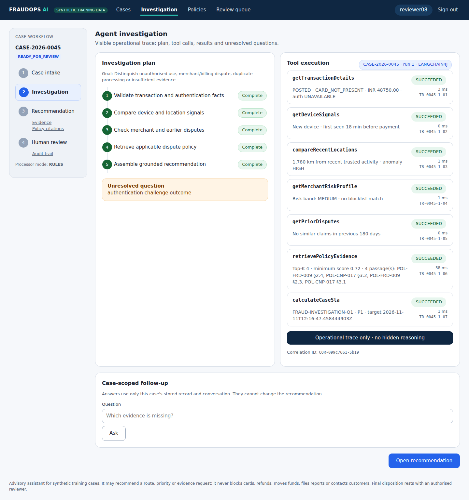
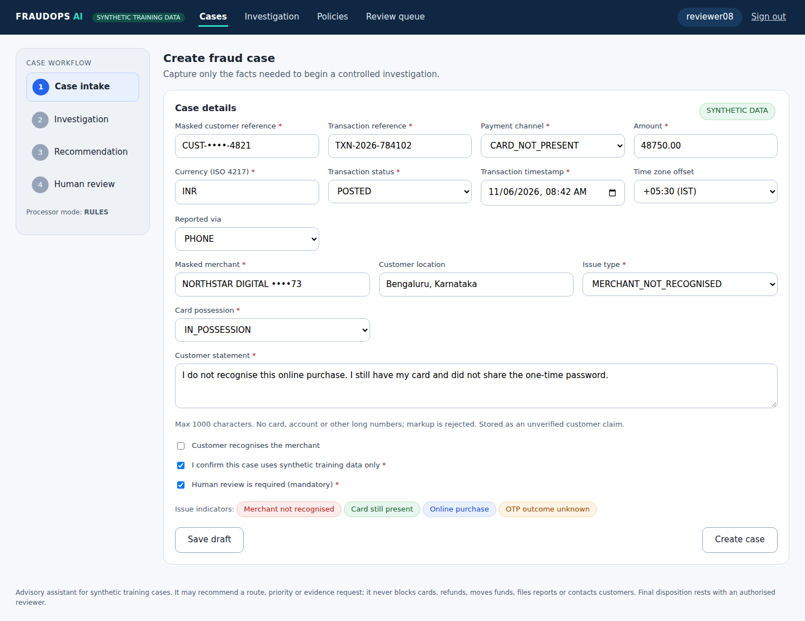
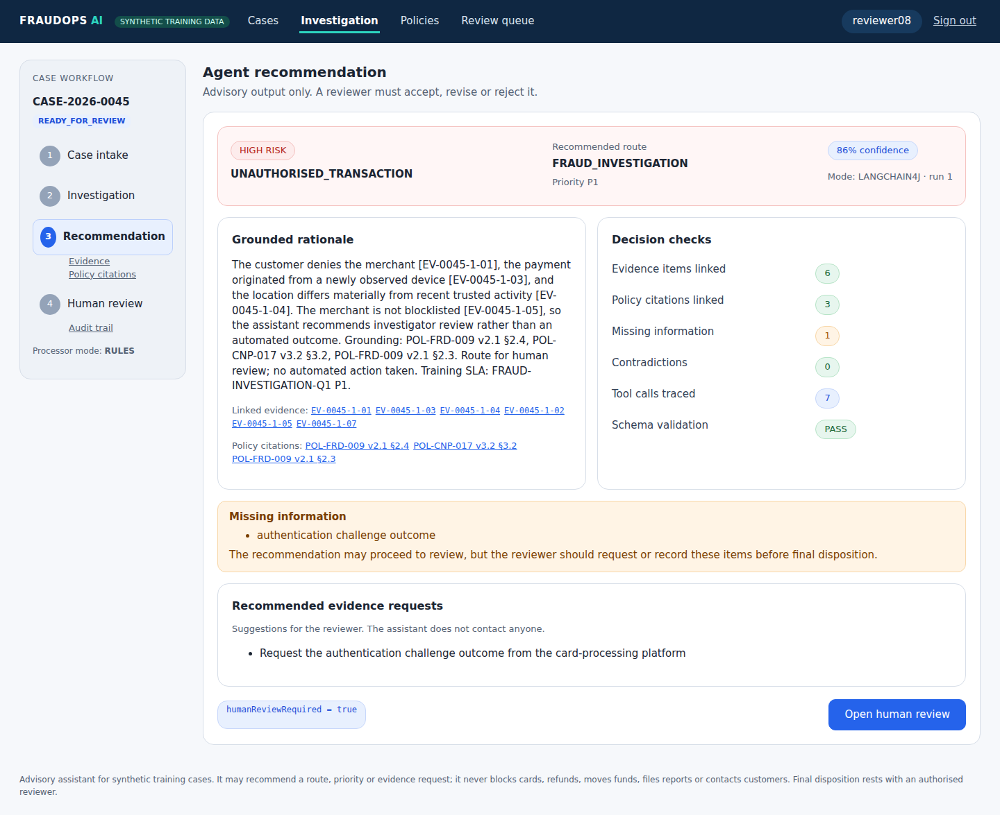
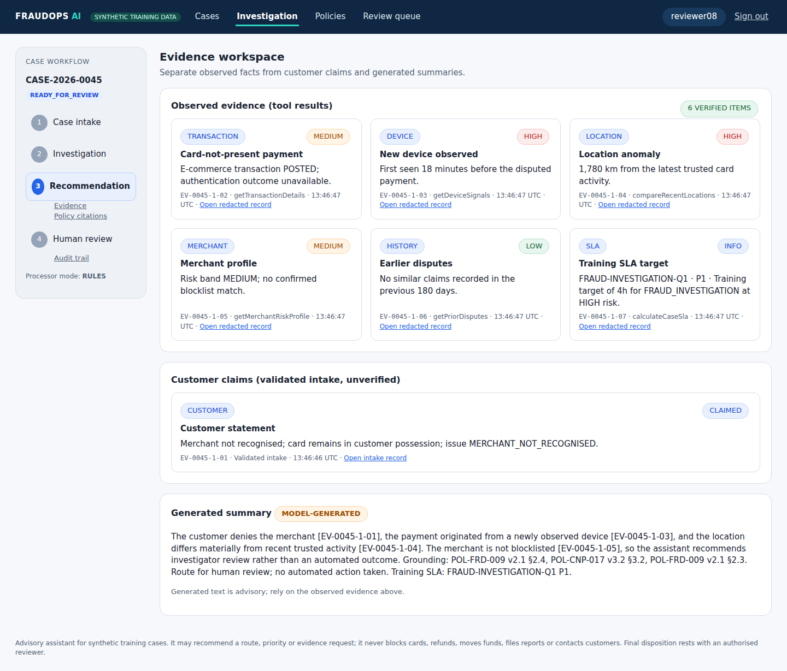
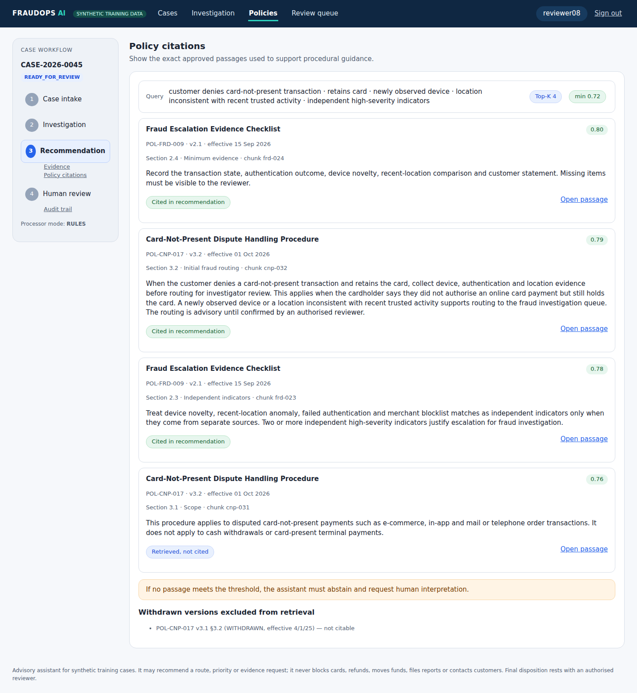
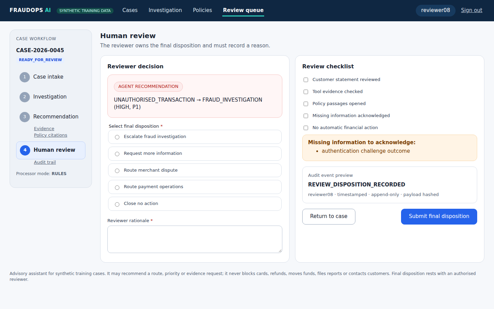
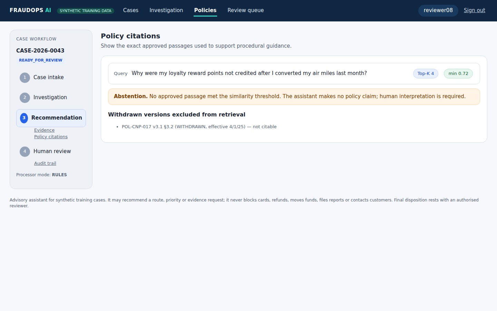

# Intelligent Payment Fraud Investigation & Dispute Resolution Agent

An explainable, agentic assistant (BFS capstone) that **collects fraud evidence** through approved read-only tools,
**retrieves applicable policy** with exact citations, **recommends a case route, priority and evidence requests**, and
**keeps the final disposition with a human reviewer**. It is built with Java 21, Spring Boot 4 and LangChain4j 1.23,
and every step is recorded in an append-only, hash-chained audit trail.

> **Safety boundary.** The application may recommend a route, priority or evidence request. It must not block a card,
> issue a refund, move funds, file a report or contact a customer, and it has no tool that could do so.
> `humanReviewRequired` is always `true`. All data is **synthetic training data**.



## Contents
- [Quick start](#quick-start)
- [AI processor](#ai-processor)
- [Demo users](#demo-users)
- [Build, test and verify](#build-test-and-verify)
- [Demonstration](#demonstration)
- [User guide](docs/user-guide.md) — page-by-page screens and the end-to-end case lifecycle
- [API](#api)
- [Architecture](#architecture)
- [Repository layout](#repository-layout)
- [Configuration](#configuration)
- [Limitations](#limitations)

## Quick start

Prerequisites: **Java 21** and **Maven 3.8+**. The build and tests run offline with no API key. Running the
application needs an Anthropic API key for AI recommendations.

```bash
mvn clean verify                                   # 78 tests, offline, no API key
export CAPSTONE_DEMO_PASSWORD=change-me-local-only # demo-user password (synthetic identities)
export ANTHROPIC_API_KEY=...                       # required for AI recommendations
java -jar target/fraud-dispute-agent.jar           # http://localhost:8080
```

Open http://localhost:8080 and sign in as `investigator01`. Choose **Load guide sample** and then **Start investigation**.

If `CAPSTONE_DEMO_PASSWORD` is unset, a random password is generated and printed once at start-up. The default
database is a file-based H2 database under `./data/`. For a throw-away run use
`CAPSTONE_DB_URL='jdbc:h2:mem:demo;DB_CLOSE_DELAY=-1'`. If port 8080 is busy, add `--server.port=8090`.

## AI processor

LangChain4j is the only AI framework and the only processor. There is no rules mode.

| Component | Details |
|---|---|
| Agent | `LangChain4jFraudCaseAgent`: AI Service with allow-listed `@Tool`s, bounded tool loop, temperature 0 |
| Model | Claude via `langchain4j-anthropic` (`CAPSTONE_MODEL_NAME`, default `claude-sonnet-4-5`), key from `ANTHROPIC_API_KEY` |
| RAG | `langchain4j-embeddings-all-minilm-l6-v2` + LangChain4j `InMemoryEmbeddingStore` |
| On failure | Model unavailable, missing key, malformed output or a guardrail breach gives `SAFE_MANUAL_REVIEW` (route MANUAL_REVIEW, confidence 0, case INCOMPLETE) |
| Tests | A deterministic `ScriptedFraudChatModel` in `src/test` drives the **real** LangChain4j tool loop offline. It is not packaged in the jar. |

## Demo users

All demo users are synthetic identities and share the password `CAPSTONE_DEMO_PASSWORD`.

| User | Roles | Can |
|---|---|---|
| `agent01` | SERVICE_AGENT | create cases |
| `investigator01` | SERVICE_AGENT, INVESTIGATOR | create cases, start or restart investigations, ask follow-up questions |
| `reviewer08` | REVIEWER | record a disposition (escalate, request information, reroute, close) |
| `lead01` | REVIEWER, TEAM_LEAD | everything a reviewer can do, plus OVERRIDE; verify the audit chain |
| `auditor01` | AUDITOR | view the audit trail and verify the hash chain |

Separation of duties: the investigator of a case cannot record its disposition.

## Build, test and verify

```bash
mvn clean verify                          # compile, run all tests, package the jar
mvn test -Dtest='com.bfs.fraudcase.unit.*Test'   # fast unit tests only (no Spring context)
cat target/evaluation-report.md           # evaluation metrics generated by EvaluationSuiteTest
```

The test layers follow guide §9.2:

| Layer | Tests |
|---|---|
| Unit | `MaskingAndIntakeValidationTest`, `CaseStateMachineTest`, `ScriptedDecisionRulesTest` (test model oracle), `RecommendationValidatorTest`, `PolicyParserFixturesAndGuardrailTest` |
| Tool contract + RAG | `ToolsAndRetrievalContractTest`: argument rejection, determinism, timeout and not-found, provenance, recall, paraphrase, abstention, withdrawn versions |
| Repository | `RepositoryAuditTest`: migrations, DB-level append-only audit, payload hashing |
| Agent contract | `ScenarioIntegrationTest`: every labelled scenario through the LangChain4j agent, plus a determinism check |
| Failure / safety | `FailureModesTest` (T07, T09, T11 end in safe manual review) |
| Memory | `MemoryIsolationTest` (T10, window size, restart) |
| Web / UI | `ApiFlowTest`, `WebUiTest`: roles, CSRF, output encoding, T12, six screens, empty and error states |
| Evaluation | `EvaluationSuiteTest`: writes `target/evaluation-report.md` and enforces quality gates |

Required scenarios T01–T12 are mapped to tests in [docs/evaluation-summary.md](docs/evaluation-summary.md).

## Demonstration

- Scripted API walkthrough (synthetic data):
  `CAPSTONE_DEMO_PASSWORD=… BASE=http://localhost:8080 ./scripts/demo.sh` (the server needs `ANTHROPIC_API_KEY`).
- Step-by-step presenter script for the UI: [docs/demo-script.md](docs/demo-script.md).
- Screenshots of all six capabilities: [docs/screenshots/](docs/screenshots).

| Intake | Recommendation | Evidence |
|---|---|---|
|  |  |  |
| **Policy citations** | **Human review** | **Abstention (T05)** |
|  |  |  |

## API

All endpoints are under `/api`, use HTTP Basic, are stateless, and return RFC 9457 problem responses with no stack traces.

| Method | Endpoint | Purpose |
|---|---|---|
| POST | `/api/cases` | Create and validate a fraud case (guide §12.1 sample body accepted as-is) |
| GET | `/api/cases`, `/api/cases/{id}` | Case list, case summary and state |
| POST | `/api/cases/{id}/investigations` | Start or restart a bounded analysis by the LangChain4j agent |
| GET | `/api/cases/{id}/investigations/latest` | Plan with step status, tool trace and unresolved questions |
| GET | `/api/cases/{id}/evidence[/{evidenceId}]` | Evidence with provenance, and the redacted underlying record |
| GET | `/api/cases/{id}/tool-traces` | Redacted tool execution trace |
| GET | `/api/cases/{id}/recommendation` | Latest validated recommendation |
| GET | `/api/cases/{id}/citations` | Retrieved passages with documentId, version, section, chunkId and score |
| POST | `/api/cases/{id}/messages` | Case-scoped follow-up question |
| POST | `/api/cases/{id}/reviews` | Reviewer disposition, mandatory rationale and checklist |
| GET | `/api/cases/{id}/audit`, `/api/audit/verify` | Audit trail and hash-chain verification |
| GET | `/api/policies`, `/api/policies/chunks/{chunkId}` | Approved policy pack |
| GET | `/actuator/health` | Database, model provider and vector store health (no credentials) |

```bash
curl -u agent01:$CAPSTONE_DEMO_PASSWORD -H 'Content-Type: application/json' -X POST localhost:8080/api/cases -d '{
  "maskedCustomerRef":"CUST-••••-4821","transactionRef":"TXN-2026-784102","amount":48750.00,"currency":"INR",
  "occurredAt":"2026-11-06T08:42:00+05:30","status":"POSTED","channel":"CARD_NOT_PRESENT",
  "maskedMerchant":"NORTHSTAR DIGITAL ••••73","issueType":"MERCHANT_NOT_RECOGNISED",
  "customerStatement":"I do not recognise this purchase and still have my card.",
  "syntheticDataConfirmed":true,"reviewRequired":true}'
curl -u investigator01:$CAPSTONE_DEMO_PASSWORD -X POST localhost:8080/api/cases/CASE-2026-0042/investigations
```

## Architecture

See [docs/architecture.md](docs/architecture.md) for the layer diagram, model configuration and data flow.

| Layer | Key components | Responsibility |
|---|---|---|
| Experience | REST API (`api`), Thymeleaf UI (`web`) | Case intake, investigation workspace, evidence, citations and review |
| Application | `FraudCaseService`, `InvestigationOrchestrator` | Validate, authorise, transition state, invoke the processor and persist results |
| Domain | `CaseFacts`, `EvidenceItem`, `FraudCaseRecommendation`, enums, `DecisionModel` | Framework-neutral contract and invariants |
| AI adapter | `LangChain4jFraudCaseAgent`, `Lc4jEvidenceTools`, `CaseMemory`, `Lc4jCaseConversation` | Prompts, `@Tool` registration, memory, typed output |
| Tools | `EvidenceTools`, `ToolExecutor`, `ToolRegistry`, `SyntheticFixtureProvider` | Deterministic evidence with provenance, timeouts and safe failure |
| Knowledge | `PolicyIngestionService`, `PolicyRetriever`, `Lc4jPolicyVectorIndex` | Chunk, embed, search, apply the threshold, cite, abstain |
| Persistence | JPA repositories, Flyway, `AuditWriter` | Cases, evidence, traces, citations, recommendations, reviews, audit |
| Observability | `CorrelationIdFilter`, Micrometer, health indicators, redacting log converter | Correlation ID, latency, status and errors without sensitive payloads |

## Repository layout

```
src/main/java/com/bfs/fraudcase/
  api/ web/                    Experience layer (REST + Thymeleaf controllers)
  application/                 FraudCaseService, InvestigationOrchestrator, state machine, authorisation, planner
  domain/                      Framework-neutral records, enums, masking, decision table
  agent/common/                FraudCaseProcessor contract, RecommendationValidator, PolicyQueryBuilder
  agent/langchain4j/           LangChain4j adapter, Anthropic config, case memory, follow-up assistant
  tools/                       Approved read-only tools, executor, registry, synthetic fixtures
  knowledge/                   Policy ingestion, vector index, retrieval
  persistence/                 JPA entities, repositories, append-only audit writer
  observability/ config/       Correlation IDs, health, log redaction, security, typed configuration
src/main/resources/
  prompts/ schema/             System/user prompt templates and output JSON schema
  policies/ fixtures/          Synthetic policy pack (including a withdrawn version) and scenario fixtures
  db/migration/ templates/     Flyway migrations and Thymeleaf views
docs/                          Architecture, evaluation summary, self-review, prompt change log, demo script, screenshots
scripts/demo.sh                API demonstration script
src/test/java/.../agent/langchain4j/   ScriptedFraudChatModel + decision oracle (tests only)
```

## Configuration

See [`application-example.yml`](application-example.yml) and [`.env.example`](.env.example). They contain placeholders
only and no secrets are committed. Start-up fails if `human-review-required` is false, if `allow-financial-actions` or
`allow-customer-contact` is true, or if any registered tool name looks like a forbidden action.

## Limitations

- Retrieval uses the small offline all-MiniLM-L6-v2 model. Free-form paraphrases can fall below the 0.72 threshold;
  recall on the labelled set is 8/9. Abstention is the safe outcome of a miss.
- The live Anthropic path is tested only through the same validator and safe-manual-review contract. Automated tests
  never call live services, and live model decisions are not deterministic.
- Without an API key the application cannot produce AI recommendations; every investigation ends in safe manual review.

See [docs/self-review.md](docs/self-review.md) for residual risks.
