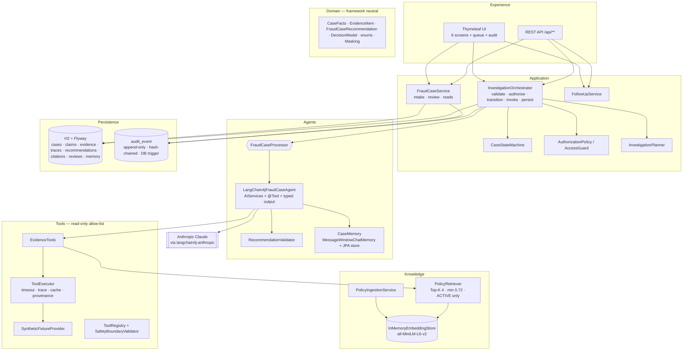

# Architecture

## Layer view

## Model configuration

- LangChain4j is the only AI framework and `LangChain4jFraudCaseAgent` is the only `FraudCaseProcessor`. There is no
  rules mode and no per-request mode selection.
- `Lc4jConfig` builds an `AnthropicChatModel` from `capstone.model.*` (`ANTHROPIC_API_KEY`, `CAPSTONE_MODEL_NAME`).
  Without a key an `UnconfiguredChatModel` is used. It always fails, so the safe manual-review path applies and the
  `modelProvider` health component reports DEGRADED.
- Safe failure: if the model is unavailable (T07), output is malformed (T09) or a guardrail is breached (T11), the
  attempt is audited (`MODEL_UNAVAILABLE` / `RECOMMENDATION_REJECTED`), the case gets a safe `MANUAL_REVIEW` result
  with confidence 0 and moves to INCOMPLETE (`SAFE_MANUAL_REVIEW`, audited as `FALLBACK_APPLIED`).
- Tests replace the Anthropic model with the test-scoped `ScriptedFraudChatModel` (`@Primary` bean in
  `ScriptedModelTestConfig`). It drives the real AI Service tool loop deterministically and is not packaged in the jar.

## Data flow of one investigation

1. **Intake** (`POST /api/cases` or the intake screen). `IntakeValidator` checks mandatory fields, masking, Luhn-based
   PAN rejection, ISO currency, enums, statement length and markup, and the synthetic/review confirmations. The case ID
   and analyst identity come from the server and the authenticated principal. The original statement is stored
   separately from the sanitised one. Instruction-like text is flagged and audited (`PROMPT_INJECTION_SUSPECTED`).
2. **Authorise and transition.** `AccessGuard` requires INVESTIGATOR and audits denials. NEW/INCOMPLETE → ENRICHING
   happens under optimistic locking, so a second concurrent run gets 409.
3. **Plan.** `InvestigationPlanner` builds a deterministic five-step bounded plan that lists the allow-listed tools.
4. **Act and observe.** The processor calls `EvidenceTools`. The model chooses the calls through
   `@Tool` methods, bounded by `maxSequentialToolsInvocations`; any tool name outside the allow-list is rejected and
   traced. `ToolExecutor` validates arguments, enforces a 2.5 s timeout, converts failures into structured
   `TIMEOUT` / `NOT_FOUND` / `UNAVAILABLE` / `REJECTED` results with missing-information entries, records a redacted
   trace (request hash, status, duration, summary) and assigns evidence IDs with provenance.
5. **Retrieve.** `retrievePolicyEvidence` builds the query from case type, evidence indicators and the goal. It runs a
   Top-K 4 search with minimum score 0.72 over ACTIVE, currently effective chunks, keeps only the latest version of each
   document, and returns exact metadata, or an empty list (abstention).
6. **Assess and recommend.** The model returns JSON that is mapped explicitly onto `RawRecommendation`.
7. **Validate.** `RecommendationValidator` rejects:
   - unknown enums, confidence outside [0, 1], or a missing or mismatched caseId;
   - evidence, trace or citation IDs that were not produced in this session;
   - claims of completed actions, or procedural claims without a citation;
   - a route that is not permitted by the classification table.

   It also forces `humanReviewRequired=true`. Application facts always win over model claims: retrieval scores,
   priority derived from route and risk, and missing information from failed tools.
8. **Persist.** Evidence, traces, the recommendation (validated only; raw model output is never stored), all retrieved
   passages (flagged cited / not cited) and the state change to READY_FOR_REVIEW or INCOMPLETE are written in one
   transaction. A masked summary is added to case-keyed memory.
9. **Review.** A REVIEWER who is not the investigator selects a disposition, gives a rationale of at least 10
   characters and acknowledges all five checklist items. OVERRIDE requires TEAM_LEAD. The flow is
   READY_FOR_REVIEW → UNDER_REVIEW → ROUTED, CLOSED or INCOMPLETE. Routing is a label only; nothing is executed.
10. **Audit.** Every step appends an `audit_event`. Each event holds only a redacted summary and the SHA-256 of its
    payload, plus `prevHash` and `entryHash`. Each append commits in its own transaction under a lock, so the chain
    never forks. H2 triggers reject UPDATE and DELETE. `GET /api/audit/verify` recomputes the chain.

## State model

| State | Meaning | Next |
|---|---|---|
| NEW | Captured, not enriched | ENRICHING |
| ENRICHING | Tools and retrieval running | READY_FOR_REVIEW, INCOMPLETE |
| INCOMPLETE | Evidence missing, contradictory or unavailable, or analysis unavailable | ENRICHING, CLOSED |
| READY_FOR_REVIEW | Validated recommendation available | UNDER_REVIEW |
| UNDER_REVIEW | Reviewer evaluating | ROUTED, CLOSED, INCOMPLETE* |
| ROUTED | Reviewer selected an operational route | CLOSED |
| CLOSED | Final disposition recorded | — |

\* This transition is an extension of the guide: *Request more information* returns the case to INCOMPLETE so it can be
re-enriched. Failures never leave a case in ENRICHING; `failSafe` moves it to INCOMPLETE.

## Memory

- Investigation runs are stateless, with a fresh bounded tool loop each time. This means a 12-message window can never
  evict tool results in the middle of an analysis.
- After a run, a masked summary is written to the case-keyed memory, where the key is the caseId (validated as a case
  ID). Memory is persisted in `chat_memory`, so it survives restarts, and is used by `Lc4jCaseConversation` for
  follow-up questions.
- Follow-up context is assembled only from the requested case's persisted record. Follow-ups cannot change the
  recommendation.
